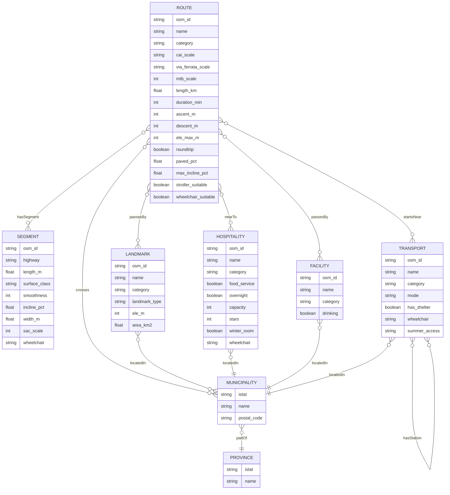

# ER model — Trentino hikes KG (Phase 1, Purpose Definition)

First (graphical) version of the KG structure: entity types (ETypes), their attributes and the relationships between them, derived from the personas, scenarios and competency questions in `initial-proposals.md` and checked against the cleaned data in `data/clean/`.

Scope of this version:
- **weather is left out for now** (handled separately; it will be added as its own entities later);
- the **focus** of each EType (Common / Core / Contextual) is not assigned yet (team decision).

## Entity types (8)

| EType | What it is | `category` values | Data (`data/clean/`) |
|---|---|---|---|
| **Route** | a path that can be followed from start to end | `trail`, `mtb`, `bicycle`, `foot`, `via_ferrata` | trails, mtb, foot_routes, via_ferrata |
| **Segment** | one stretch of a route (an OSM way); shared by several routes | – (`highway` is an attribute) | ways |
| **Landmark** | a natural or cultural point of interest that a route reaches or passes by | natural: `peak`, `saddle`, `viewpoint`, `waterfall`, `cave_entrance`, `cliff`, `lake`, `glacier`; cultural: `wayside_shrine`, `wayside_cross`, `ruins`, `memorial`, `military_remains`, `castle`, `fort`, `archaeological_site`, `mine`, `monument`, `place_of_worship`, `attraction`, ... | landmarks, cultural_landmarks, lakes, glaciers |
| **Hospitality** | a place where one can eat and/or sleep | `alpine_hut`, `wilderness_hut`, `hotel`, `apartment`, `motel`, `guest_house`, `bed_and_breakfast`, `agritourism`, `camp_site`, `chalet`, `hostel`, `restaurant`, `bar`, `cafe`, `fast_food`, `pub` | huts (alpine and wilderness huts), accommodations, food_drink |
| **Facility** | a service along the way | `water_point`, `rest_area`, `guidepost`, `tourist_info`, `emergency_shelter` | water_points, rest_areas, guideposts, tourist_info, huts (emergency shelters) |
| **Transport** | where one boards a means of transport, or a lift line | stops: `bus_stop`, `bus_station`, `train_station`, `funicular_station`, `lift_station`; lift lines: `chair_lift`, `gondola`, `cable_car` | transport_stops, aerialways |
| **Municipality** | a municipality (comune) of the province | – | municipalities |
| **Province** | the Autonomous Province of Trento | – | province |

Design choices:
- **Landmark** includes lakes and glaciers (they are reached or seen along a route, like a peak or a waterfall). Water points, rest areas, guideposts and tourist offices are **not** landmarks: they are services (**Facility**). Otherwise "passes by landmark X" (CQ #21) and "at least 3 landmarks" (student persona) would be flooded by ~4000 fountains.
- **Hospitality** merges huts, accommodations and food & drink places. CQ #4 (food) and CQ #5 (overnight stay) become two attributes of the same EType, `food_service` and `overnight`, and objects that are both (a hut with a kitchen, a hotel with a restaurant) are one entity.
- **Emergency shelters** (lean-to, basic huts, rock shelters) are not hospitality: they are a **Facility**.
- **Transport** merges stops/stations and lift lines. The line–station link is a relationship of Transport with itself (`hasStation`).
- **Municipality** and **Province** are separate ETypes, so that the `partOf` relationship between them is explicit.

## Attributes
Identifying attributes (they uniquely identify an instance) are marked **(id)**. Derived attributes (computed from other data in the integration step, not read from a tag) are marked *(derived)*. Every EType also has the common attributes `name: string`, `name_source: string`, `wikidata: string` (where present).

### Route
| Attribute | Type | CQ / persona |
|---|---|---|
| **osm_id (id)** | string (`relation/{id}`, `via_ferrata/{slug}`) | – |
| ref | string (trail number) | label |
| category | string | #10 (bike), #19 (equipped) |
| from, to | string | label |
| cai_scale | string (T, E, EE, EEA) | difficulty, #19 |
| via_ferrata_scale | string (1 … 6, with +/-) | #19 |
| mtb_scale | int (0–6) | #10, MTB persona |
| distance_km | float (declared) | #18 |
| length_km | float (computed from geometry) | #18 |
| duration_min | int | #8, student persona |
| ascent_m, descent_m | int | #1, #6 |
| ele_max_m, ele_min_m | int | #9, alpinist persona |
| roundtrip | boolean | #20, alpinist persona |
| start, end | point (lat, lon) | #11, #17, elderly persona |
| operator | string list | – |
| paved_pct *(derived)* | float | #7, #16, couple persona |
| max_incline_pct *(derived)* | float | #2, MTB persona |
| stroller_suitable *(derived)* | boolean | #3, family persona |
| wheelchair_suitable *(derived)* | boolean | #15, elderly persona |

### Segment
| Attribute | Type |
|---|---|
| **osm_id (id)** | string (`way/{id}`) |
| highway | string (path, track, residential, steps, via_ferrata, ...) |
| length_m | float |
| surface | string |
| surface_class | string (paved / unpaved) |
| smoothness | int (1–8) |
| incline_pct | float |
| width_m | float |
| sac_scale | int (0–6) |
| mtb_scale | int (0–6) |
| bicycle_allowed | boolean |
| wheelchair | string (yes / limited / no) |
| stroller | boolean |

Segments are the input of the derived Route attributes (`paved_pct`, `max_incline_pct`, `stroller_suitable`, `wheelchair_suitable`).

### Landmark
| Attribute | Type | CQ / persona |
|---|---|---|
| **osm_id (id)** | string | – |
| category | string | #21 |
| landmark_type | string (natural / cultural) | #21 |
| ele_m | int | #9 |
| location | point (lat, lon) | spatial joins |
| area_km2 | float (lakes and glaciers only) | – |
| mountain_pass | boolean (saddles) | – |

### Hospitality
| Attribute | Type | CQ / persona |
|---|---|---|
| **osm_id (id)** | string | – |
| category | string | – |
| food_service | boolean (true only if stated by a tag) | #4, family persona |
| overnight | boolean | #5, alpinist persona |
| capacity | int | #5 |
| stars | int (hotels) | – |
| winter_room | boolean (huts) | – |
| cuisine | string list | #4 |
| opening_hours | string | – |
| wheelchair | string (yes / limited / no) | elderly persona |
| ele_m | int | – |
| location | point (lat, lon) | spatial joins |
| operator | string list | – |
| phone, email, website | string list / string / string | – |

`overnight` = true for huts, bivouacs and accommodations; false for restaurants, bars, cafes, fast food and pubs.

### Facility
| Attribute | Type |
|---|---|
| **osm_id (id)** | string |
| category | string (water_point, rest_area, guidepost, tourist_info, emergency_shelter) |
| drinking | boolean (water points) |
| ele_m | int |
| location | point (lat, lon) |

### Transport
| Attribute | Type | CQ / persona |
|---|---|---|
| **osm_id (id)** | string | – |
| category | string | #11 |
| mode | string (bus, train, funicular, aerialway) | #11, student persona |
| has_shelter | boolean (stops) | – |
| wheelchair | string (yes / limited / no) | elderly persona |
| summer_access | string (lift stations/lines: no, both, entry, exit) | #11 (lifts usable in summer) |
| duration_min | float (lift lines) | – |
| location | point (lat, lon) | #11 |

### Municipality
| Attribute | Type |
|---|---|
| **istat (id)** | string (6 digits) |
| osm_id | string (`relation/{id}`) |
| postal_code | string |
| location | point (lat, lon of the administrative centre) |

### Province
| Attribute | Type |
|---|---|
| **istat (id)** | string ("022") |
| osm_id | string (`relation/45756`) |
| iso3166_2 | string ("IT-TN") |

## Relationships

| Relationship | From → To | Cardinality | Source | CQ / persona |
|---|---|---|---|---|
| hasSegment | Route → Segment | N : M (a segment can belong to several routes) | in the data (`main_way_ids`) | #2, #3, #7, #15, #16 (via derived attributes) |
| passesBy | Route → Landmark | N : M | spatial join (to compute) | #21, student persona (≥ 3 landmarks), couple persona |
| passesBy | Route → Facility | N : M | spatial join; guideposts already in the data (`guidepost_node_ids`) | water points / rest areas along the way |
| nearTo | Route → Hospitality | N : M | spatial join (to compute) | #4, #5, alpinist persona (bivouacs) |
| startsNear | Route → Transport | N : M | spatial join on `start`/`end` (to compute) | #11, student persona |
| crosses | Route → Municipality | N : M (≥ 1) | spatial join (to compute) | zone queries |
| hasStation | Transport (lift line) → Transport (station) | N : M | spatial join (to compute) | #11 |
| locatedIn | Landmark → Municipality | N : M (a lake can touch several municipalities) | in the data (`municipality_istat`, `municipalities_istat`) | zone queries |
| locatedIn | Hospitality, Facility, Transport → Municipality | N : 1 | in the data (`municipality_istat`) | zone queries |
| partOf | Municipality → Province | N : 1 | in the data (`province_istat`) | – |

## CQ coverage
| # | CQ | Path in the model |
|---|---|---|
| 1, 6 | height difference less than / equal to X | Route.ascent_m, descent_m |
| 2 | maximum slope X | Route.max_incline_pct *(derived from Segment.incline_pct; sparse, DEM planned)* |
| 3 | stroller | Route.stroller_suitable *(derived from Segments)* |
| 4 | food points | Route –nearTo→ Hospitality [food_service = true] |
| 5 | overnight stay | Route –nearTo→ Hospitality [overnight = true] |
| 7, 16 | no asphalt / totally asphalted | Route.paved_pct *(derived)*; Segment.surface |
| 8 | less than X hours | Route.duration_min |
| 9 | reach X m a.s.l. | Route.ele_max_m (sparse, DEM planned); Landmark.ele_m of the landmarks it passes by |
| 10 | by bike | Route.category ∈ {mtb, bicycle}; Segment.bicycle_allowed |
| 11 | reachable by public transport | Route –startsNear→ Transport |
| 15 | wheelchair | Route.wheelchair_suitable *(derived)* |
| 17 | near me | Route.start / end (distance at query time) |
| 18 | length X | Route.length_km / distance_km |
| 19 | equipped | Route.category = via_ferrata, or via_ferrata_scale set, or cai_scale = EEA |
| 20 | loop | Route.roundtrip |
| 21 | passes by landmark X | Route –passesBy→ Landmark |
| 12, 13, 14, 22 | weather (good weather, wet, snow, weather for zone X) | **out of this version** (weather entities to be added) |

## From the model to the data files
The data follows this model in `data/entities/`: **one file per EType** (`routes`, `segments`, `landmarks`, `hospitality`, `facilities`, `transport`, `municipalities`, `province`), with a uniform schema, built from the cleaned files in `data/clean/` by `cleaning/build_entities.py`. Every field is described in `data/entities/SCHEMA.md` (generated from the data). The derived Route attributes and the relationships marked "to compute" will be produced in the integration step (spatial joins).
